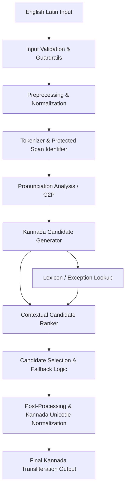

# NEXUS: English-to-Kannada Transliteration System

> **Document Control Version**: 2.0 (PRD) & 1.0 (Implementation Plan) | **Date**: October 2026  
> **Under the Guidance of**: Dr.Girish L  

---

## 📌 Executive Summary & Scope Baseline

**NEXUS** is an NLP-driven English-to-Kannada transliteration system designed to convert English text written in the Latin alphabet into Kannada script while faithfully preserving the pronunciation of the source text.

```
       [ Latin-Script English Input ]
                     │
                     ▼
             ┌───────────────┐
             │  N E X U S    │
             └───────────────┘
                     │
                     ▼
    [ Kannada-Script Phonetic Rendering ]
```

### 🚨 Critical Scope Guardrail: Transliteration vs. Translation

NEXUS performs **phonetic transliteration**, **NOT semantic translation**:
* **Transliteration (In Scope)**: Representing source pronunciation in another script.
  * `"Hello"` $\rightarrow$ **`"ಹೆಲ್ಲೋ"`**
  * `"Computer"` $\rightarrow$ **`"ಕಂಪ್ಯೂಟರ್"`**
  * `"Good morning"` $\rightarrow$ **`"ಗುಡ್ ಮಾರ್ನಿಂಗ್"`**
* **Translation (Out of Scope)**: Converting meaning into target language vocabulary.
  * `"Hello"` $\rightarrow$ `"ನಮಸ್ಕಾರ"` *(Incorrect behaviour for NEXUS)*

---

## 🎯 Project Goals & Non-Goals

### Core Objectives
1. **Phonetic Fidelity**: Faithfully render spoken English sounds in Kannada script without substituting semantic equivalents.
2. **Context & Span Handling**: Process isolated words, multi-word phrases, and full sentences while preserving token sequence, spacing, and punctuation.
3. **Specialized Vocabulary**: Consistently handle proper nouns, personal names, geographical entities, technical terms, and acronyms.
4. **Disambiguation & Fallback**: Resolve context-dependent pronunciations using surrounding evidence; provide graceful fallbacks and uncertainty indicators for low-confidence or out-of-vocabulary (OOV) inputs.
5. **Unicode Normalization**: Prevent broken combining sequences and ensure standard, render-safe Kannada Unicode output.
6. **Empirical Benchmarking**: Quantify performance against held-out test sets using standardized metrics (CER, WER, Exact Match).

### Explicit Non-Goals (Phase 1)
* Semantic English-to-Kannada translation.
* Kannada-to-English translation or transliteration.
* Romanized Kannada (Kanglish) to Kannada script conversion.
* Speech recognition (ASR), text-to-speech (TTS), or real-time voice translation.
* Image OCR transliteration.
* Automated unverified online learning from user inputs.

---

## 💡 The Core Problem: Irregular English Orthography

English spelling does not map one-to-one to pronunciation. Letter combinations produce varying sounds, silent letters occur frequently, and word stress alters phonetics. Conversely, Kannada script is predominantly phonetic and syllabic (alphasyllabary/abugida).

| Challenge | Illustrative Pattern | Potential Failure / Risk | NEXUS Handling Strategy |
| :--- | :--- | :--- | :--- |
| **Multiple Pronunciations** | `"read"` (present /riːd/ vs. past /rɛd/) | Contextual mismatch | Sentence-level context modeling ($X(k, \text{ctx})$) |
| **Silent Letters** | `"know"`, `"write"`, `"psychology"` | Naive phonetic artifacts (`"ಕ್ನೋವ್"`) | Grapheme-to-Phoneme (G2P) analysis & dictionary lookup |
| **Digraphs** | `"sh"`, `"ch"`, `"ph"`, `"th"` | Character-by-character distortion | Multi-character subword / phoneme tokenization |
| **Vowel Variations** | `"a"` in `"cat"`, `"car"`, `"call"`, `"about"` | Unintended vowel diacritics | Lexical and acoustic phonetic representation |
| **Proper Nouns & Names** | Non-standard or foreign spellings | Inconsistent or mangled renderings | Curated name lexicon & canonical spelling policy |
| **Loanword Conventions** | Established vs. phonetic place names | Discrepancy between phonetics & conventions | Documented canonical preference hierarchy |

---

## 📋 Illustrative Transliteration Matrix

| Input Type | English Input | Illustrative Kannada Output | Policy / Notes |
| :--- | :--- | :--- | :--- |
| **Common Word** | `Hello` | `ಹೆಲ್ಲೋ` | Phonetic rendering; strictly not `"ನಮಸ್ಕಾರ"` |
| **Technical Vocabulary** | `Machine learning` | `ಮಷೀನ್ ಲರ್ನಿಂಗ್` | Documented technical vocabulary policy |
| **Borrowed / Loanword** | `Computer` | `ಕಂಪ್ಯೂಟರ್` | Standard conventional borrowing |
| **Multi-Word Phrase** | `Good morning` | `ಗುಡ್ ಮಾರ್ನಿಂಗ್` | Preserves word sequence and spacing |
| **Full Sentence** | `The school is open.` | `ದ ಸ್ಕೂಲ್ ಈಸ್ ಓಪನ್.` | Punctuation and structure retained |
| **Proper Noun (City)** | `Bangalore` | `ಬ್ಯಾಂಗಲೋರ್` | Strict phonetic (vs. conventional `"ಬೆಂಗಳೂರು"`) |
| **Personal Name** | `Bhuvanesh` | `ಭುವನೇಶ್` | Dedicated name transliteration handling |
| **Protected Spans** | `https://example.com` | `https://example.com` | URLs, emails, and code spans preserved |

---

## 🏗️ System Architecture & Pipeline

NEXUS uses a modular NLP architecture designed for independent unit testing, benchmarking, and maintainability.



### Detailed Pipeline Stages

1. **Input Layer & Validation**: Verifies Latin-script input, checks boundary length limits, rejects empty inputs, and isolates protected spans (URLs, code, emails).
2. **Preprocessing & Normalization**: Strips excessive whitespace while preserving semantic casing metadata and punctuation.
3. **Tokenization / Segmentation**: Breaks input into sentences, words, subwords, and punctuation tokens.
4. **Pronunciation Analysis (G2P)**: Maps graphemic patterns into phonetic representations using CMU Pronouncing Dictionary and G2P engines (e.g., `g2p-en` / `Phonetisaurus`).
5. **Candidate Generation**: Generates viable Kannada-script representations combining lexicon lookups and phonetic rule synthesis.
6. **Candidate Ranking & Selection**: Evaluates candidate validity using weighted acoustic, lexical, and contextual scoring.
7. **Post-Processing & Output Normalization**: Enforces Unicode Kannada block consistency, handles virama / vowel-modifier rules, and reconstructs spacing and punctuation.

### 🖥️ End-to-End Pipeline Execution Trace

The CLI execution trace below illustrates how an English token flows through each modular stage of the pipeline in real-time:

```text
Enter English text: hello

INPUT:
hello

VALIDATION:
Input accepted

NORMALIZATION:
hello

TOKENIZATION:
['hello']

PRONUNCIATION ANALYSIS:
hello: no configured multi-letter pattern; individual-letter rules will be used

CANDIDATE GENERATION:
hello: dictionary, phonetic rules -> ಹೆಲ್ಲೋ

CANDIDATE SELECTION:
hello -> ಹೆಲ್ಲೋ (score 150, dictionary, phonetic rules)

POST-PROCESSING:
ಹೆಲ್ಲೋ

FINAL OUTPUT:
ಹೆಲ್ಲೋ
```

---

## 🧮 Proposed Hybrid Algorithmic Formulation

NEXUS employs a hybrid architecture pairing a high-precision lexicon dictionary with an adaptable phonetic rule engine.

### 1. Candidate Generation Formula
For any English token $w$, let $D(w)$ denote candidates from the curated dictionary and $R(w)$ denote candidates synthesized by phonetic rules:

$$C(w) = D(w) \cup R(w)$$

If $C(w) = \emptyset$, the token is routed to the unknown-word fallback module.

### 2. Candidate Scoring & Selection Formula
Each candidate $k \in C(w)$ is evaluated using a weighted multi-factor objective:

$$\text{Score}(k \mid w, \text{ctx}) = \alpha \cdot P(k, w) + \beta \cdot L(k, w) + \gamma \cdot X(k, \text{ctx})$$

Where:
* $P(k, w) \in [0, 1]$: Phonetic correspondence score between source sound units and candidate $k$.
* $L(k, w) \in [0, 1]$: Lexical evidence score based on dictionary frequency and approved status.
* $X(k, \text{ctx}) \in [0, 1]$: Contextual fit score given surrounding tokens $\text{ctx}$.
* $\alpha, \beta, \gamma \ge 0$: Non-negative weights tuned on validation data (for context-free baseline: $\gamma = 0, \alpha + \beta = 1$).

### 3. Selection & Fallback Decision
$$k^* = \arg\max_{k \in C(w)} \text{Score}(k \mid w, \text{ctx})$$

$$\text{Output}(w) = \begin{cases} k^* & \text{if } \text{Score}(k^* \mid w, \text{ctx}) \ge \tau \\ \text{Fallback}(w) & \text{if } \text{Score}(k^* \mid w, \text{ctx}) < \tau \end{cases}$$

Where $\tau$ is the empirically calibrated confidence threshold.

---

## 💻 Repository Structure

```
NEXUS/
├── data/
│   ├── raw/                 # Unprocessed source datasets
│   ├── processed/           # Normalized & deduplicated train/val splits
│   └── test/                # Held-out benchmark test sets
├── models/
│   ├── checkpoints/         # Trained model weights and rule caches
│   └── configurations/      # Model & pipeline hyperparameters (YAML/JSON)
├── src/
│   ├── __init__.py
│   ├── input_handler.py     # Input intake & validation
│   ├── preprocessing.py     # Whitespace & casing normalization
│   ├── normalization.py     # Script & character set normalization
│   ├── tokenizer.py         # Word, punctuation & protected span segmentation
│   ├── pronunciation.py     # English G2P & phoneme mapping
│   ├── candidate_generator.py # Dictionary lookup & phonetic candidate synthesis
│   ├── candidate_ranker.py  # Weighted candidate scoring (alpha, beta, gamma)
│   ├── postprocessing.py    # Kannada Unicode normalization & formatting
│   └── transliteration.py   # Core end-to-end pipeline orchestrator
├── tests/
│   ├── test_validation.py   # Input edge cases and guardrail tests
│   ├── test_g2p.py          # Pronunciation analysis tests
│   ├── test_unicode.py      # Kannada Unicode rendering & normalization tests
│   └── test_regression.py   # Fixed error regression test suite
├── evaluation/
│   ├── evaluate.py          # CER, WER, and Exact Match evaluation runner
│   └── results/             # Benchmark logs, confusion matrices, and reports
├── app.py                   # Interactive Streamlit demonstration web interface
├── requirements.txt         # Project dependencies
└── README.md                # Project documentation
```

---

## 🛠️ Technology Stack

| Domain | Tool / Library | Purpose |
| :--- | :--- | :--- |
| **Language** | Python 3.10+ | Core language for development and evaluation |
| **Text & Unicode** | `unicodedata`, `regex` | Unicode normalization (NFC) & token handling |
| **Data Processing** | `pandas`, `numpy` | Dataset ingestion, deduplication, and manipulation |
| **Phonetics & G2P** | `cmudict`, `g2p-en` / `Phonetisaurus` | English grapheme-to-phoneme conversion |
| **Modeling (Exploratory)** | `torch` / `scikit-learn` | Sequence candidate ranking & neural baseline exploration |
| **Evaluation Metrics** | `editdistance`, `jiwer` | Character Error Rate (CER) and Word Error Rate (WER) |
| **Testing** | `pytest` | Automated unit, integration, and regression testing |
| **Web Interface** | `streamlit` | Interactive GUI for live user demonstration |

---

## 🚀 Getting Started

### 1. Clone the Repository
```bash
git clone https://github.com/Bhuvan-esh/Nexus.git
cd Nexus
```

### 2. Set Up a Virtual Environment
```bash
# Windows (PowerShell)
python -m venv venv
.\venv\Scripts\Activate.ps1

# Linux / macOS
python3 -m venv venv
source venv/bin/activate
```

### 3. Install Dependencies
```bash
pip install --upgrade pip
pip install -r requirements.txt
```

### 4. Run the Pipeline in Terminal (CLI Mode)
```bash
python main.py
```

### 5. Run the Interactive Web Demonstration
```bash
streamlit run app.py
```

### 6. Run the Test Suite
```bash
pytest tests/
```

### 7. Run the Benchmark Evaluation
```bash
python evaluation/evaluate.py --test-set data/test/held_out_eval.json
```

---

## 📊 Evaluation & Benchmarking Strategy

### Core Metrics
1. **Character Error Rate (CER)**: Normalized Levenshtein distance at character level:
   $$\text{CER} = \frac{S + D + I}{N}$$
2. **Word Error Rate (WER)**: Token-level substitution, deletion, and insertion rate.
3. **Exact Match Accuracy (EMA)**: Proportion of predictions identical to the preferred reference.
4. **Qualitative Phonetic Accuracy**: Human inspection of pronunciation fidelity on ambiguous samples.
5. **Latency (Median & p95)**: Inference responsiveness per token and per sentence.

### Evaluation Test Set Categories
* Common vocabulary with regular phonetic spelling.
* Words with silent letters and irregular English orthography (`"knife"`, `"doubt"`).
* Vowel digraphs and polyphonic consonants (`"ch"`, `"th"`, `"ph"`).
* Multi-syllable and compound words.
* Full sentences with punctuation and contractions.
* Personal, geographical, and organizational proper nouns.
* Technical and academic vocabulary.
* Out-of-vocabulary (OOV) and low-confidence test cases.

---

## 🔍 Error Taxonomy & Diagnostics

| Error Category | Root Cause | Diagnostic & Mitigation Strategy |
| :--- | :--- | :--- |
| **G2P Mismatch** | English spelling incorrectly mapped to phonemes | Review phonetic transcription in pronunciation module |
| **P2G Mismatch** | Correct phonemes rendered with wrong Kannada glyphs | Audit Kannada orthographic synthesis mapping table |
| **Syllabification Defect** | Misplaced consonant clusters or missing virama | Inspect conjunct formation and halant (`್`) placement |
| **Lexicon Divergence** | System overrides preferred conventional spelling | Adjust lexical weight $\beta$ relative to phonetic weight $\alpha$ |
| **Contextual Error** | Polyphonic word misclassified | Incorporate local bi-gram / n-gram context features |
| **Unicode Malformation** | Malformed combining character sequence | Enforce NFC normalization via `unicodedata.normalize('NFC', text)` |

---

## 📅 Development Roadmap & Milestones

| Phase | Milestone | Duration | Target Deliverables |
| :---: | :--- | :---: | :--- |
| **Phase 1** | Scope & Setup | Week 1 | Repository setup, documentation, development environment |
| **Phase 2** | Data Audit & Acquisition | Week 2 | Transliteration corpus acquisition, licence review, data inventory |
| **Phase 3** | Data Preparation | Week 3 | Data cleaning, Unicode validation, train/val/test splits |
| **Phase 4** | Baseline Development | Week 4 | Simple rule-based G2P mapping, initial CER/WER benchmark |
| **Phase 5** | Core Modules | Weeks 5–6 | Pronunciation analyzer, candidate generator, ranking engine |
| **Phase 6** | Integration & Testing | Week 7 | Pipeline assembly, unit tests, edge-case and regression tests |
| **Phase 7** | Evaluation & Demo | Week 8 | Final evaluation report, held-out benchmarking, Streamlit prototype |

---

## 🔮 Future Enhancements (Phase 2)

Following successful validation of the core English-to-Kannada engine, NEXUS may be expanded to support:
* **Multilingual Input Handling**: Robust handling of code-mixed text and non-English Latin words.
* **Noisy Text Resolution**: Graceful handling of phonetic typos, SMS lingo, and informal spellings.
* **Cross-Script Normalization**: Support for reverse transliteration and Romanized Kannada (Kanglish).
* **Named Entity Recognition (NER)**: Automated entity detection for context-aware name vs. word disambiguation.
* **Low-Latency REST API**: Containerized microservice deployment for external integrations.

---

## 👥 Project Team & Academic Governance

* **Project**: NEXUS
* **Author / Developer**: J Bhuvanesh, S.Md.Naqeeb, Nitin S
* **Under the Guidance of**: Dr.Girish L  
* **Department**: AI & ML, AI & DS  
* **Date**: October 2026  
